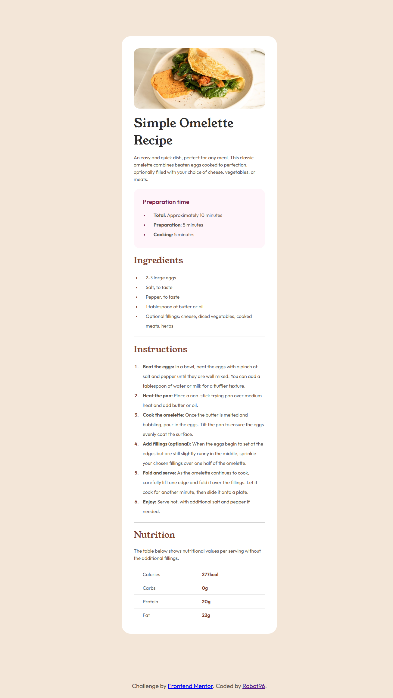

# Frontend Mentor - Recipe page solution

This is a solution to the [Recipe page challenge on Frontend Mentor](https://www.frontendmentor.io/challenges/recipe-page-KiTsR8QQKm). Frontend Mentor challenges help you improve your coding skills by building realistic projects. 

## Table of contents

- [Overview](#overview)
  - [Screenshot](#screenshot)
  - [Links](#links)
- [My process](#my-process)
  - [Built with](#built-with)
  - [What I learned](#what-i-learned)
  - [Continued development](#continued-development)
  - [AI Collaboration](#ai-collaboration)
- [Author](#author)

## Overview

### Screenshot



### Links

- Solution URL: [Add solution URL here](https://your-solution-url.com)
- Live Site URL: [Add live site URL here](https://your-live-site-url.com)

## My process

This one was a little confusing at first because I decided to use the BEM style of naming, and that had many problems initially because I did not properly understand how to do it. Then, as I iterated, I was able to get a little grip on it.

Another issue that had surfaced was dealing with lists. It had many small tinkering and changes that required some Google searches and use of AI, and some new things to learn regarding how to use `::marker` in CSS.

One other thing I encountered is the image. Width was handled properly, but the height, which I usually leave as `auto`, didn't behave this time. The `` has a `height="600"` attribute in the HTML, which stretched it. At first I worked around it with `height: 20%`, which isn't really 20% of anything: it just made the browser fall back to `auto`. Later I realised I could set `height: auto` directly, which does the same job and says what I mean.

Then came the issue with the table. This demanded a lot of new things to learn for me:

- the `:not()` selector in CSS
- table collapsing (`border-collapse`)
- how to add only bottom borders or side borders, whichever you can do
- how to position the content horizontally inside a cell or a row
- using `width` on a table cell
- how to add padding inside the cell itself

These are some things I learned during this process.

### Built with

- Semantic HTML5 markup (`main`, `section`, lists, table with `th scope="row"`)
- CSS custom properties for colours and fonts
- Flexbox
- Media queries (desktop first, one breakpoint at 500px)
- BEM-style class names (`recipe__title`)
- Self-hosted fonts: Outfit (variable) and Young Serif

### What I learned

- **Class names must match exactly.** My font wasn't applying because the HTML said `recipe__title` and the CSS said `recipe_title`. I hit the same thing again with a typo in `instructions`. DevTools shows quickly whether a rule matches an element.
- **`::marker` only accepts a few properties.** `padding` isn't one of them. I got the gap between a bullet and its text by padding the `li` instead.
- **Table borders.** Row lines only show up with `border-collapse: collapse`. `tr:not(:last-child) td` puts a line under every row except the last. I also switched the row labels to `<th scope="row">`, so a screen reader can say "Calories, 277kcal".
- **Margin versus padding.** The card was stuck to the top and bottom of the screen because `min-height: 100vh` only leaves room when the container is taller than the card. A top and bottom margin on the card fixed it.
- **Media queries.** The last rule wins when two rules are equally strong, so the query must come after the rule it overrides. The 375px in the style guide is the size the design was drawn at, not a breakpoint. I found my breakpoint by dragging the window narrower until the card looked cramped.
- **Image height.** The `height="600"` attribute on the `` was stretching it, and `height: 20%` only worked by accident, since a percentage height falls back to `auto` when the parent has no set height. Writing `height: auto` is the clear way to override the attribute.
- **The style guide and the mockup can disagree.** The style guide lists the paragraph size as 16px (1rem), so I switched to it, but the text got too big and lines wrapped differently from the design. `0.8rem` matched the mockup's line breaks. When two sources disagree, I now compare the rendered result against the design image.

```css
.recipe__nutrition-table tr:not(:last-child) td,
.recipe__nutrition-table tr:not(:last-child) th {
  border-bottom: 1.5px solid hsl(0, 0%, 80%);
}
```

### Continued development

- Remove more repetition in my CSS. I already moved the shared font, size and colour onto `body` and grouped the three section titles. The table label and value cells still repeat those values, and the three list rules share the same line height and padding.
- Use named spacing and size values, like the colour variables, instead of numbers I picked by eye.
- Group my two `500px` media queries, and try a mobile-first approach.
- Add a `max-width` to the card so it looks better on tablets, and give the image a fixed shape with `aspect-ratio`.
- Heading levels. "Preparation time" is an `<h2>`, but Ingredients, Instructions and Nutrition are `<h3>`. All four are siblings, so they should share a level. Heading levels are about structure and not size, so I want to make them all `<h2>` and use CSS for the look.
- Style the footer links. They're still the default blue and purple.

### AI Collaboration

- **Tool:** Claude Code in VS Code. The project's `AGENTS.md` set it up as a mentor, so it gave hints and didn't write the code for me.
- **How I used it:** I used it to find why my font wasn't applying, why `padding` didn't work on bullets, why my media query had no effect, how to get the table lines, and how to fix the card's spacing. It also reviewed my final HTML and CSS. I used another AI once, to remove the line after the last table row. I then asked Claude to explain why that worked.
- **What worked:** Getting hints instead of answers, and asking "why does this work?" afterwards. DevTools tips from it helped me debug on my own.
- **What didn't:** Its first read of `height: 20%` was wrong. It suggested the line did nothing, but it was overriding the image's height attribute. It took me a bit more time to work out that `height: auto` was the clear fix.

## Author

- GitHub - [@robotraja96](https://github.com/robotraja96)
- Frontend Mentor - [@robotraja96](https://www.frontendmentor.io/profile/robotraja96)
