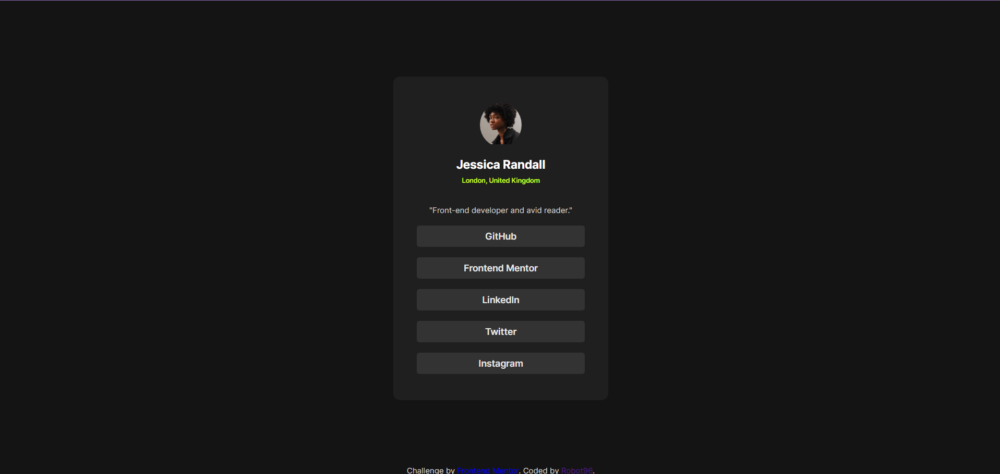

# Frontend Mentor - Social links profile solution

This is a solution to the [Social links profile challenge on Frontend Mentor](https://www.frontendmentor.io/challenges/social-links-profile-UG32l9m6dQ). Frontend Mentor challenges help you improve your coding skills by building realistic projects. 

## Table of contents

- [Overview](#overview)
  - [The challenge](#the-challenge)
  - [Screenshot](#screenshot)
  - [Links](#links)
- [My process](#my-process)
  - [Built with](#built-with)
  - [What I learned](#what-i-learned)
  - [Continued development](#continued-development)
  - [AI Collaboration](#ai-collaboration)
- [Author](#author)

## Overview

### The challenge

Users should be able to:

- See hover and focus states for all interactive elements on the page

### Screenshot



### Links

- Solution URL: [Add solution URL here](https://your-solution-url.com)
- Live Site URL: [Add live site URL here](https://your-live-site-url.com)

## My process
  This one was difficult since I did not have any dimensions or other readily available font size, border radius and other values a figma file provides. So I had to do multiple trial and error to get the output as close as possible to the design image. This time, on purpose, I used multiple different font files instead of a single variable font file with a range of weights. I am still not sure whether I got it right this time. The output looks similar but I think differences exists. One particular difference i was not able to diagnose was why the Name looks different in the image than in my output, even though computed font is the same Inter Bold
### Built with

- Semantic HTML5 markup
- CSS (Flexbox, `hsl()` colours)
- Self-hosted Inter font via `@font-face`

### What I learned

- **No Figma file.** The Figma file was behind a paywall, so I built from the flat images in the `design/` folder by eye. I learned that this is a fallback and that devs normally inspect the Figma file for exact sizes. Comparing my page next to the design at the same zoom level worked better than guessing.
- **Links must be `<a>`, not `<div>`.** My first version used `div`s for the buttons, so keyboard users couldn't tab to them. I switched to `<a href>`.
- **Put the styles on the link itself.** Wrapping an `<a>` inside a styled `div` only made the text clickable. Putting the background and padding on the `<a>` makes the whole bar clickable, and I get the pointer cursor for free.


```html
<a href="https://github.com/robotraja96" class="link semibold">GitHub</a>
```

### Continued development

- Switch `:focus` to `:focus-visible` so the lime style only shows for keyboard users, and not after a mouse click.
- Use `rem` instead of `px`.


### AI Collaboration

- **Tool:** Claude Code in VS Code. The project's `AGENTS.md` set it up as a mentor, so it gave hints and reviews and didn't write the code for me.
- **How I used it:** I had it review my `index.html` against the design images and my screenshots. It pointed out the `div` links, the missing heading, the wrong alt text, the sizes that drifted from the design, and the footer links. I made every fix myself.
- **What worked:** The review checklist, and being told *what* to look at instead of being handed code. I also asked how it got its measurements and whether devs measure images. It said they were visual estimates, not measurements, and that devs normally use Figma inspect.
- **What didn't:** Its pixel numbers were estimates, so I didn't chase them. It also wrongly guessed my footer was off-centre, and my screenshot proved it was centred.

## Author

- GitHub - [@robotraja96](https://github.com/robotraja96)
- Frontend Mentor - [@robotraja96](https://www.frontendmentor.io/profile/robotraja96)
